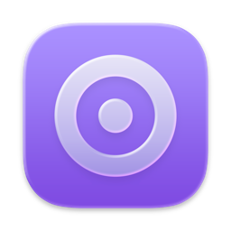
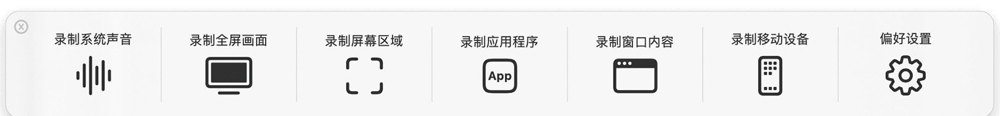
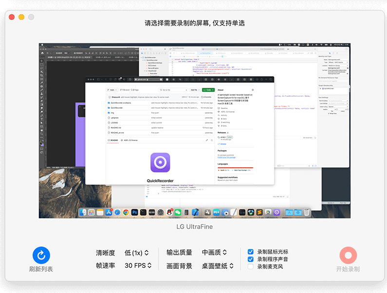
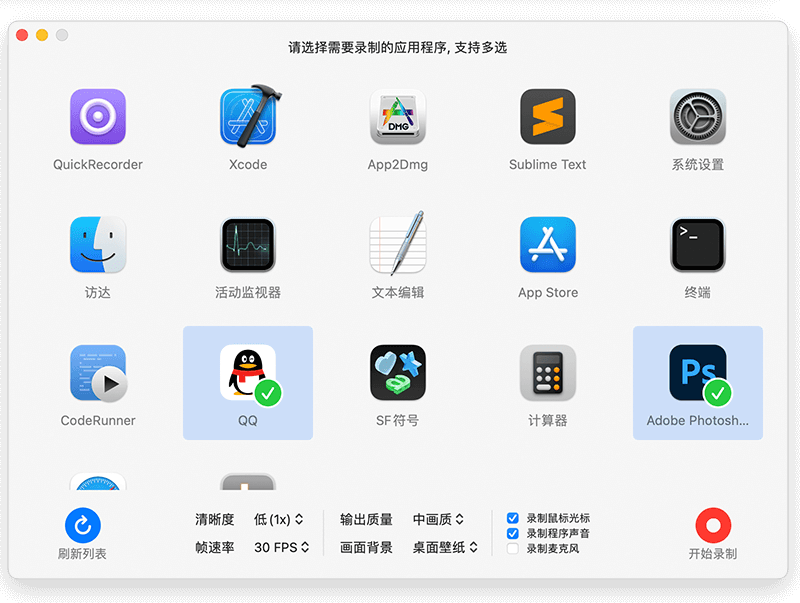
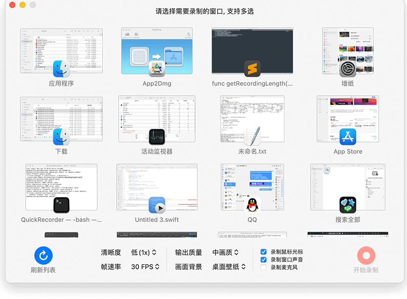
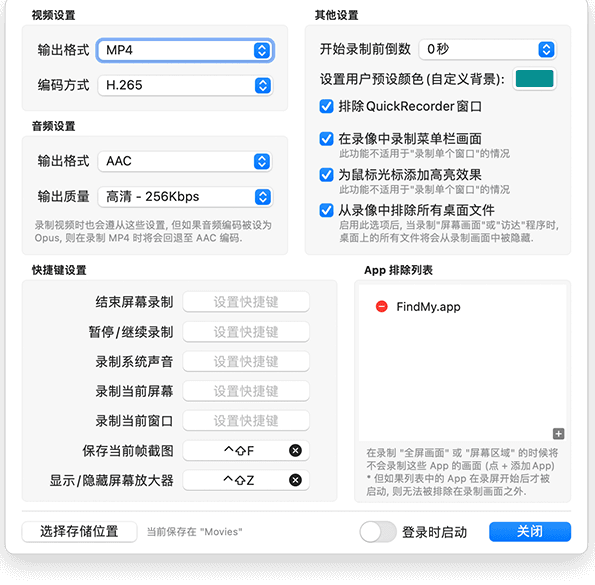

# QuickRecorder 使用手册



> 分析对象：[lihaoyun6/QuickRecorder](https://github.com/lihaoyun6/QuickRecorder) v1.6.9（源码提交 `e820517`）。
> 平台：macOS 12.3 及以上。该项目为 SwiftUI + ScreenCaptureKit + AVFoundation 实现，**不支持 Windows / Linux**。
> 许可：AGPL-3.0，应用体积小于 10 MB。
>
> 本文截图取自仓库自带的官方预览图（`img/preview*.png`）裁剪，个别界面元素（如「清晰度」文案、设置页布局）与当前源码可能略有出入，以实际版本为准。

---

## 1. 功能概览

QuickRecorder 是一款常驻菜单栏的轻量录屏工具，支持六种录制目标：

| 录制方式 | 说明 | 适用场景 |
| --- | --- | --- |
| 录制系统声音 | 只录系统音频，可同时混入麦克风 | 录歌、录会议声音、播客素材 |
| 录制全屏画面 | 录整块显示器，可含菜单栏 | 教程、演示、游戏 |
| 录制屏幕区域 | 框选任意矩形区域，支持精确定位与记忆 | 局部演示、代码片段 |
| 录制应用程序 | 按 App 录制，支持多选，其他窗口不进入画面 | 只录某个软件的窗口 |
| 录制窗口内容 | 按窗口录制，支持多选，可带壁纸桌面背景 | 单窗口或多窗口组合 |
| 录制移动设备 | 通过 USB 采集 iPhone / iPad 画面与声音 | 手机操作演示、App 录屏 |

此外还提供：HDR（macOS 15+）、带 Alpha 通道输出、演讲者前置（macOS 14+）、鼠标高亮、屏幕放大器、当前帧截图、多轨音频文件、内置剪辑与 GIF 导出、全局快捷键、AppleScript 自动化。

---

## 2. 安装与首次运行

### 2.1 安装

两种方式任选其一：

- 从 [Releases](https://github.com/lihaoyun6/QuickRecorder/releases/latest) 下载最新 `.dmg`，拖入「应用程序」；
- 使用 Homebrew：

```bash
brew install lihaoyun6/tap/quickrecorder
```

### 2.2 首次启动

1. 启动后系统会请求 **屏幕录制** 权限，必须在「系统设置 → 隐私与安全性 → 屏幕录制」中勾选 QuickRecorder，否则无法获取任何画面。
2. 首次录制麦克风 / 摄像头 / 移动设备时，会分别请求 **麦克风** 与 **摄像头** 权限。
3. 首次启动会弹窗建议切换到 H.265 编码（同画质下文件更小），可一键采纳。
4. 结束录制依赖 **通知** 权限；使用 AppleScript 时需要允许 **自动化**。
5. 程序只允许运行一个实例，重复启动会提示退出。

---

## 3. 主面板

启动后屏幕中央出现悬浮的主面板（可拖动，按 `Esc` 或点左上角 `×` 关闭）：



| 入口 | 行为 |
| --- | --- |
| 录制系统声音 | 只录系统音频；按钮下方可直接勾选「录制麦克风」并选择输入设备（macOS 13+） |
| 录制全屏画面 | 打开屏幕选择器，选择显示器后开始 |
| 录制屏幕区域 | 进入框选模式（见 4.3） |
| 录制应用程序 | 打开应用选择器，可多选 |
| 录制窗口内容 | 打开窗口选择器，可多选 |
| 录制移动设备 | 弹出已连接的 iPhone / iPad 列表 |
| 偏好设置 | 打开设置窗口 |

关闭主面板后，**单击 Dock 栏图标**即可随时重新呼出。若在设置中关闭了 Dock 图标、只保留菜单栏图标，则从菜单栏图标弹出主面板。

---

## 4. 六种录制方式

除「移动设备」外，屏幕 / 区域 / 应用 / 窗口四种选择器底部都有同一排参数控件（分辨率、帧率、质量、背景、光标、程序声音、麦克风）和一个「开始录制」按钮，详见第 5 节。

### 4.1 录制系统声音

1. 主面板点「录制系统声音」；
2. 如需同时录讲解，勾选「录制麦克风」并选择设备；
3. 结束后得到音频文件（默认 AAC `.m4a`，可在设置中改为 MP3 / FLAC / Opus / ALAC）。

系统声音无法通过麦克风采集，QuickRecorder 使用 macOS 的音频采集能力直接抓取系统输出，因此不会录入环境噪声。

### 4.2 录制全屏画面

1. 主面板点「录制全屏画面」，进入屏幕选择器；
2. 多显示器时顶部有标签页，点选要录的屏幕（仅支持单选）；
3. 按需调整底部参数，点「开始录制」。



### 4.3 录制屏幕区域

1. 主面板点「录制屏幕区域」，整屏变暗进入框选；
2. 拖拽调整选区，也可在底部输入框精确填写宽高；
3. 底部工具从左到右依次为：贴合窗口区域（Window Area）、重新调整（Resize）、返回（Back）、参数区、定时停止、开始录制；
4. 选区按「显示器名」记忆，下次框选会自动恢复上次的位置和尺寸；
5. 参数区会实时显示实际输出像素（高分屏下为逻辑尺寸 × 缩放倍率）。

### 4.4 录制应用程序

1. 主面板点「录制应用程序」；
2. 在图标列表中点击 App 进行多选（勾选图标右上角出现绿勾）；顶部标签页切换显示器；
3. 点「开始录制」。



只采集选中 App 的窗口；桌面上其他内容不会入镜。背景色参数决定 App 窗口之外显示什么（壁纸 / 纯色 / 透明）。

### 4.5 录制窗口内容

1. 主面板点「录制窗口内容」；
2. 点击窗口缩略图多选；底部「刷新列表」重新扫描；
3. 可选开关：
   - **Show Windows with No Title**：显示无标题窗口；
   - **Don't Create Thumbnails**：不生成缩略图（窗口很多时更快）；
4. 点「开始录制」。



只选一个窗口时按「单窗口」方式录制：窗口独立成片，鼠标高亮与摄像头叠加不可用，背景色也不生效。选多个窗口时以组合方式录制，可叠加壁纸或纯色背景、Dock 和菜单栏。

### 4.6 录制移动设备

1. 用 USB 线连接 iPhone / iPad，并在设备上点「信任」并解锁；
2. 主面板点「录制移动设备」，在列表中选择设备；
3. 列表下方还有两个选项：
   - **Mute**：正在用手机通话时开启，避免把通话声音重复录进去；
   - **Preset**：采集预设 Low / Medium / High，默认 High；
4. 屏幕上出现竖版镜像悬浮窗（300×500），可拖动；点悬浮窗右下角按钮可关闭镜像（不影响录制）；
5. 录制期间菜单栏控制器上的眼睛图标可显示 / 隐藏镜像；
6. 停止后通过系统通知告知保存路径。

移动设备录制不支持暂停；视频编码格式沿用设置中的视频参数，录制结束不弹预览浮窗。

---

## 5. 录制参数

选择器底部统一提供以下参数（默认值来自首次运行注册的偏好）：

| 参数 | 可选值 | 默认 | 说明 |
| --- | --- | --- | --- |
| 清晰度 / Resolution | High (auto)、Normal (1x) | High | High 按 Retina 实际像素录制；Normal 按逻辑分辨率 |
| 帧率 / Frame Rate | 240 / 144 / 120 / 90 / 60 / 30 / 24 / 15 / 10 FPS | 60 | 高帧率会显著增大文件与 CPU 占用 |
| 输出质量 / Quality | 高 / 中 / 低 | 高 | 影响目标码率倍率 |
| 画面背景 / Background | 壁纸、透明*、黑、白、灰、黄、橙、绿、蓝、红、自定义 | 壁纸 | 仅在全屏 / 区域 / 应用 / 多窗口时生效 |
| 录制鼠标光标 | 开 / 关 | 开 | 单窗口录制不支持 |
| 录制程序声音 | 开 / 关 | 开 | macOS 13+ |
| 录制麦克风 | 开 / 关 + 设备选择 | 关 | 勾选后可在同一行切换输入设备 |
| Record HDR | 开 / 关 | 关 | 仅 macOS 15+，会锁定 HEVC 编码 |
| 定时停止 | 0–99 分钟 | 0 | 点击计时器图标设置，到时自动停止 |

\* 「透明」背景仅在设置中开启「带 Alpha 通道录制」后出现，并且强制 MOV + H.265。

---

## 6. 录制过程中的控制

录制开始后，菜单栏出现紫色胶囊控制器：

| 控件 | 作用 |
| --- | --- |
| 红色停止按钮 | 结束并保存 |
| 暂停 / 继续 | 跳过中间片段，暂停期间不计入时长（移动设备录制不支持暂停） |
| 计时器 | 显示已录时长（分:秒） |
| 相机按钮 | 打开摄像头设备列表，启用/切换摄像头悬浮窗（系统声音、单窗口、移动设备录制时不可用） |
| 眼睛按钮 | 显示 / 隐藏移动设备镜像 |

相关行为：

- **迷你模式**：设置中开启「Mini size Menu Bar controller」后，控制器只显示计时，鼠标悬停才展开按钮。
- **菜单栏隐藏时**：如果同时关闭了菜单栏图标，控制器会以悬浮小窗形式出现在屏幕顶部中央。
- **开始倒计时**：设置「Delay Before Recording」后，画面中央出现紫色倒计时面板，可点 Cancel 取消。
- **保存当前帧**：绑定快捷键后按一下即可把当前画面存为 PNG（文件名以 `Capturing at` 开头），不打断录制。
- **屏幕放大器**：绑定快捷键后可开启跟随鼠标的放大镜窗口，用于演示细节；鼠标移到菜单栏控制器上时自动隐藏，避免被录进去。
- **演讲者前置（macOS 14+）**：系统开启该效果后，QuickRecorder 会自动让出画面区域，关闭普通摄像头悬浮窗；若启用后录制失败，可在设置中增大「Presenter Overlay Delay」。
- **防睡眠**：录制期间默认阻止 Mac 进入睡眠，结束后恢复。

---

## 7. 结束录制之后

### 7.1 浮窗预览

默认在屏幕角落弹出录制结果缩略图（6 秒无操作自动消失，鼠标悬停则保留）：

- 点击播放按钮直接用默认播放器打开；
- 右键菜单：

| 菜单项 | 说明 |
| --- | --- |
| Show in Finder | 在访达中定位文件 |
| Delete | 直接删除该文件 |
| Copy | 把文件复制到剪贴板 |
| 共享… | 调起系统分享面板 |
| Trim | 打开内置剪辑窗口（已开启自动剪辑时不显示） |
| Make GIF | 调用 Gifski 转 GIF；未安装时引导去 App Store |
| Close | 关闭浮窗 |

如果关闭了「Show floating preview after recording」，则改为发送系统通知，通知里包含保存路径。

### 7.2 内置剪辑

- 在预览浮窗右键选「Trim」，或在设置中开启「Open video trimmer after recording」自动打开；
- 也可以把 `.mp4` / `.mov` 文件拖到 QuickRecorder 的 Dock 图标上，直接打开剪辑窗口；
- 使用系统播放器的裁剪条选择起止点，点保存后以 **直通方式**（不重新编码）导出；
- 新文件命名为 `原文件名 (Cropped in 2026-10-24 21.30.00).mp4`，完成后发送通知。

### 7.3 输出位置

默认保存到「影片」文件夹；在「设置 → 输出 → 输出文件夹」中修改。目录不存在时会在开始录制前自动创建。

---

## 8. 多轨音频 `.qma`

当录制 **系统声音 + 麦克风**（纯音频模式），或视频录制中关闭了「将麦克风录制到主音轨」时，两条音轨需要分别保存：

- 纯音频多轨会生成一个 `.qma` 包（本质是文件夹，内含 `sys.<格式>`、`mic.<格式>` 和 `info.json`）；
- 双击 `.qma` 即用 QuickRecorder 内置播放器打开，可：
  - 播放 / 暂停 / 拖动进度；
  - 分别调节 **系统声** 与 **麦克风** 音量（0–400%）；
  - 「Save Changes」保存音量设置；
  - 「Export」按当前音量比例混合导出为单个音频文件。

视频录制关闭主音轨合并后，系统声与麦克风会作为两条独立音轨写入同一个视频文件，可在 Final Cut Pro、iMovie 等后期软件中独立调节。

---

## 9. 设置



> 官方预览图为旧版单页布局；当前版本左侧为分类侧边栏，分为 通用 / 录制 / 输出 / 快捷键 / 黑名单 五页，选项内容一致。

### 9.1 通用

| 选项 | 默认 | 说明 |
| --- | --- | --- |
| Launch at Login | 关 | 开机自启（macOS 13+） |
| Show QuickRecorder on Dock | 开 | 是否显示 Dock 图标 |
| Show QuickRecorder on Menu Bar | 关 | 是否常驻菜单栏图标 |
| 更新设置 | — | Sparkle 自动更新，可手动「检查更新」 |

### 9.2 录制

| 选项 | 默认 | 说明 |
| --- | --- | --- |
| Delay Before Recording | 0 秒 | 开始前倒计时，0–99 秒 |
| Presenter Overlay Delay | 1 秒 | 演讲者前置启用后的等待时间（macOS 14+） |
| Custom Background Color | 黑 | 「自定义」背景色 |
| Mini size Menu Bar controller | 关 | 菜单栏控制器迷你模式 |
| Prevent Mac from sleeping while recording | 开 | 录制时阻止睡眠 |
| Show floating preview after recording | 开 | 录制后弹出预览浮窗 |
| Open video trimmer after recording | 关 | 录完立即进入剪辑 |
| Exclude QuickRecorder itself | 开 | 不把自身窗口录进画面 |
| Include Menu Bar in Recording | 开 | 全屏 / 区域录制时包含菜单栏（macOS 13+） |
| Hide Control Center Icons | 关 | 隐藏时钟、Wi-Fi、蓝牙、音量等图标 |
| Highlight the Mouse Cursor | 关 | 鼠标点击/移动高亮；单窗口录制不支持 |
| Exclude Files on Desktop | 关 | 录制时隐藏桌面文件图标 |

### 9.3 输出

| 选项 | 可选值 | 默认 |
| --- | --- | --- |
| 音频质量 | 128 / 192 / 256 / 320 Kbps（无损格式时固定显示 Lossless） | 256 Kbps |
| 音频格式 | MP3 / AAC / ALAC / FLAC / Opus | AAC |
| Record Microphone to Main Track | 开 / 关 | 开（macOS 13+） |
| Enable Acoustic Echo Cancellation | 开 / 关 | 关 |
| Audio Ducking Level | Min / Mid / Max | Mid（macOS 14+） |
| 视频格式 | MOV / MP4 | MP4 |
| 编码器 | H.264 / H.265 | H.264；首次启动会建议一键切换为 H.265 |
| Recording with Alpha Channel | 开 / 关 | 关；开启后强制 MOV + H.265 |
| 输出文件夹 | 任意目录 | 「影片」 |

注意：启用「回声消除」后，麦克风设备需保持为 `Default` 才会生效，否则参数区会显示警告；具体输入设备请在系统设置中选择。

### 9.4 快捷键

可分别为以下动作录制全局快捷键：打开主面板、结束录制、暂停/继续、录制系统声音、录制当前屏幕、录制最前窗口、框选区域、保存当前帧、显示/隐藏屏幕放大器。默认不绑定，官方截图中演示的是 `⌥F`（保存当前帧）和 `⌥Z`（屏幕放大器）。

### 9.5 黑名单

选择不希望在「全屏 / 屏幕区域」录制中出现的 App（如密码管理器、聊天工具）。被排除的 App 在录制开始 **之前** 已运行才有效；录制开始后才启动的 App 无法被排除。单窗口、应用、窗口组合录制不受黑名单影响。

---

## 10. AppleScript 自动化

应用内置脚本字典（`Scriptable.sdef`），可被 Shortcuts、Automator、终端脚本调用。首次调用需在「系统设置 → 隐私与安全性 → 自动化」中允许。

| 命令 | 参数 | 说明 |
| --- | --- | --- |
| `record screen` | `numbered <整数>` | 录指定序号的屏幕；省略则打开屏幕选择器 |
| `record screen area` | — | 进入框选模式 |
| `record application` | `named <App 名>` | 录指定应用；省略则打开应用选择器 |
| `record window` | `titled <窗口标题>`、`in application <App 名>` | 录指定窗口；省略则打开窗口选择器 |
| `record system audio` | `microphone <布尔>` | 只录系统音频，可临时开关麦克风 |
| `configure` | `hires`、`fps`、`quality`、`cursor`、`sound`、`microphone`、`mic device`、`hdr` | 修改录制参数 |

示例：

```applescript
tell application "QuickRecorder"
    -- 录 1 号屏幕，60 帧，高质量，不录光标
    configure hires true fps 60 quality 3 cursor false sound true microphone false
    record screen numbered 1
end tell
```

```applescript
tell application "QuickRecorder"
    -- 录主窗口标题为 "Untitled" 的 TextEdit 窗口
    record window titled "Untitled" in application "TextEdit"
end tell
```

```applescript
tell application "QuickRecorder"
    -- 只录系统声音，同时录麦克风
    record system audio microphone true
end tell
```

说明：

- 命令会立即返回，录制由应用异步启动（若设置了倒计时，会先走倒计时）；
- 正在录制时再次调用会弹出「Already recording!」；
- 应用或窗口不存在、重名、跨多屏等歧义情况会提示并回退到手动选择界面；
- `quality` 取 1/2/3 分别对应低/中/高。

---

## 11. 输出文件

| 类型 | 命名 / 扩展名 | 备注 |
| --- | --- | --- |
| 视频 | `Recording at 2026-10-24 21.30.00.mp4` / `.mov` | 时间格式 `年-月-日 时.分.秒` |
| 音频 | 前缀同为 `Recording at`，扩展名 `.m4a` / `.flac` / `.ogg` | MP3 在录制结束后由 LAME 转码 |
| 多轨音频 | 前缀同为 `Recording at`，扩展名 `.qma` | 包内两轨 + `info.json` |
| 当前帧截图 | `Capturing at 2026-10-24 21.30.00.png` | HDR 模式下输出 10-bit PNG |
| 剪辑结果 | `原名 (Cropped in 时间).扩展名` | 直通导出，不再编码 |

支持的编码组合：

| 场景 | 容器 / 编码 |
| --- | --- |
| 常规 | MP4 或 MOV，H.264 / H.265（硬件编码优先） |
| 带 Alpha 通道 | MOV + HEVC with Alpha（iMovie / Final Cut Pro 可识别） |
| HDR | HEVC Main10，BT.2020 PQ 色彩空间（macOS 15+） |

---

## 12. 常见问题

**主面板关掉后怎么打开？**
单击 Dock 图标即可；若关闭了 Dock 图标，则点菜单栏图标。也可以设置一个「打开主面板」快捷键。

**为什么录制没有画面 / 提示没有权限？**
到「系统设置 → 隐私与安全性 → 屏幕录制」确认 QuickRecorder 已勾选，修改后通常需要重启应用。

**为什么不是沙盒应用？**
作者为保证录制能力与使用便利，未上架 App Store，也未启用 App Sandbox；因此首次安装需要通过系统隐私授权。

**录音里系统声和麦克风混在一起了，能分开吗？**
关闭「输出 → Record Microphone to Main Track」。之后音频会保存为两条音轨（视频）或 `.qma` 包（纯音频），可独立调音量。

**为什么选不了「透明」背景？**
需要先在「输出」中开启「Recording with Alpha Channel」，并接受强制使用 MOV + H.265。

**鼠标高亮 / 摄像头悬浮窗为什么灰掉了？**
这两种效果不支持单窗口录制；另外系统声音与移动设备录制也不提供摄像头悬浮窗。

**黑名单里的 App 还是被录进去了？**
黑名单只对全屏和区域录制生效，且只排除录制开始前已经在运行的 App。

**H.265 和 H.264 怎么选？**
H.265 体积更小、画质更好，但老设备或部分剪辑软件兼容性较差；H.264 兼容性最好。首次启动的推荐可以随时在「输出」中改回。

**能同时在多台显示器上录吗？**
一次只能录一块屏幕（多窗口 / 多应用需在同一块屏幕上），但选择器支持多显示器标签页切换。

---

## 13. 附：实现要点（开发者参考）

- **画面采集**：ScreenCaptureKit（`SCContentFilter` / `SCStream`），按屏幕、应用、窗口或区域构造过滤器；支持排除应用、排除指定窗口、包含菜单栏。
- **写文件**：`AVAssetWriter` 分别写入视频与音频轨；H.264 先用 `VTCompressionSessionCreate` 探测硬件编码器，不支持当前分辨率时提示切换 H.265。
- **暂停**：通过 PTS 偏移（`timeOffset`）把暂停区间从时间轴中扣掉，而不是停止采集。
- **扬声器 / 麦克风混音**：默认把麦克风轨合并进主音轨；关闭后保留双轨，供后期软件处理。
- **多轨音频**：`.qma` 是自定义文档包（UTI `com.lihaoyun6.QuickRecorder.qma`），播放器分别解码两轨并按音量实时混合，导出时重新编码。
- **演讲者前置**：读取 `SCStreamFrameInfo.presenterOverlayContentRect` 判断系统叠加状态，并在切换后延迟恢复写帧，避免画面错位。
- **菜单栏控制器**：`NSStatusItem` + SwiftUI 视图；菜单栏不可见时退化为屏幕顶部的浮动 `NSWindow`。
- **自动更新**：Sparkle 2（`SUFeedURL` 指向 `appcast.xml`）。
- **快捷键**：KeyboardShortcuts 库，全局注册 9 个动作。
- **自动化**：`NSScriptCommand` 子类 + `Scriptable.sdef`，实现 6 条 AppleScript 命令。
